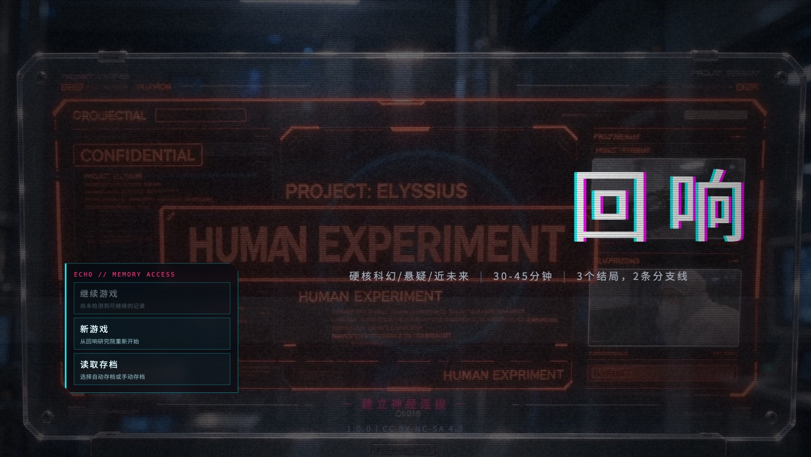
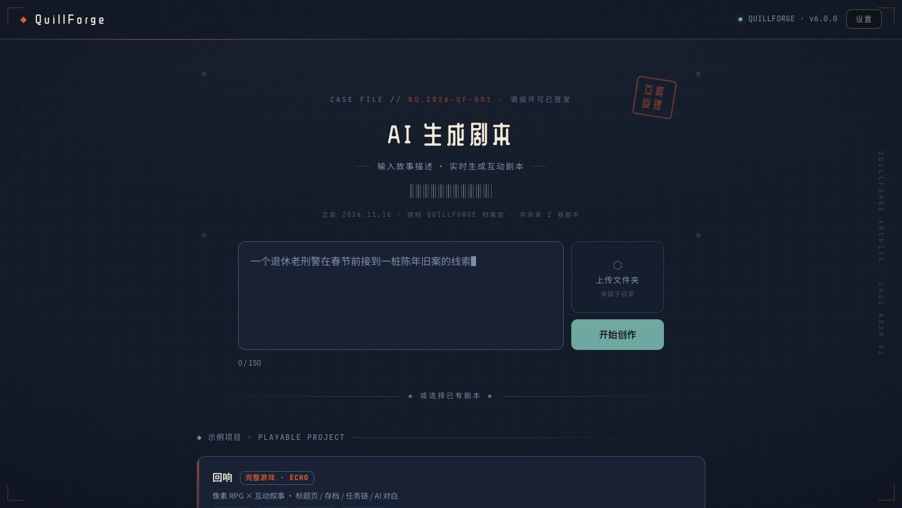
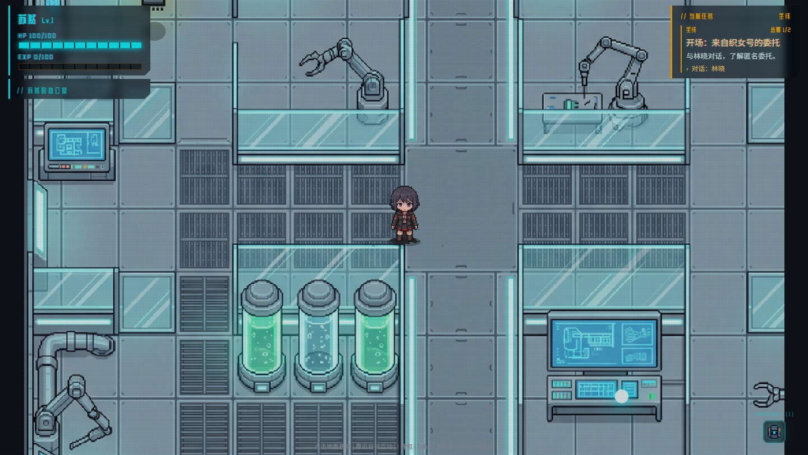
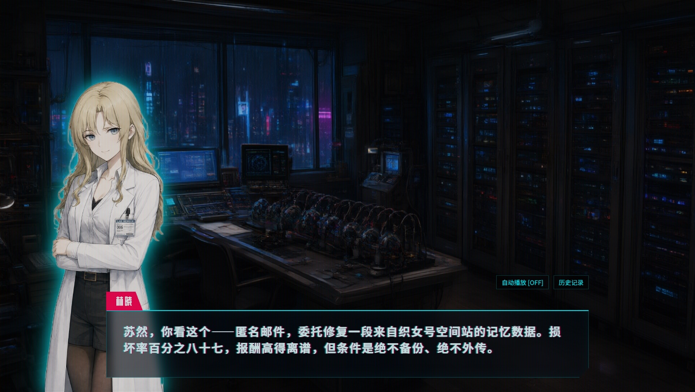
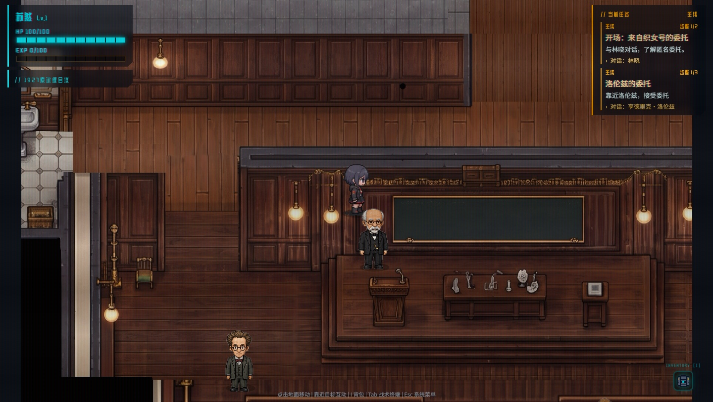
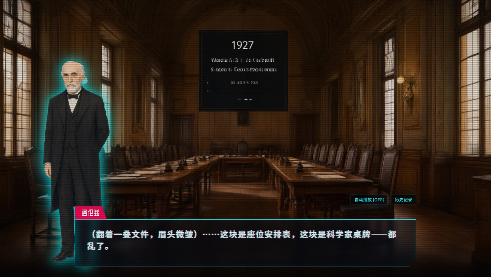
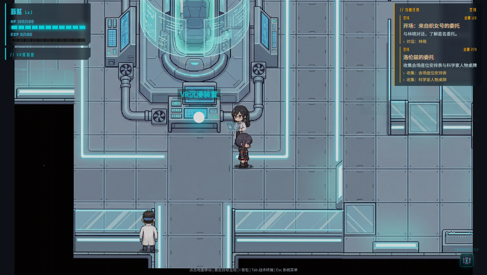
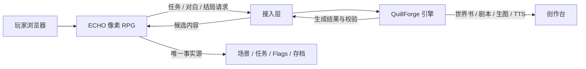

# QuillForge × ECHO

一套可独立运行、也可组合成完整链路的互动叙事项目。

**ECHO** 是面向玩家的像素 RPG：场景探索、任务推进、NPC 对白、背包、Flags 与存档都在这里发生。
**QuillForge** 是面向创作者的叙事引擎：读取世界书、角色和节拍，生成对白、任务、剧本、场景图与语音。
**接入层**负责把两边接起来，让引擎生成的内容进入 ECHO，同时不夺走 ECHO 对运行态的所有权。



## 项目定位

这不是一个把大模型塞进对话框的演示，而是一套把生成式叙事约束在可玩结构里的工程实现：

- **生成归引擎**：五阶段流水线、剧本生成、实时生成、生图、TTS、内容安全与剧本锚点校验。
- **运行归 ECHO**：场景、任务、道具、Flags、存档与结局判定始终由游戏侧持有。
- **项目可插拔**：引擎核心不认识 ECHO。新增项目只需增加一个接入模块，在 `QUILLFORGE_PROJECTS` 中登记。
- **没有引擎也能玩**：手工制作的索尔维 1927 路线不依赖大模型；生成式入口在引擎缺席时会明确降级。

## 三条体验动线

### 索尔维 1927：手工考据的历史现场

以 1927 年索尔维会议为舞台，人物、争论与科学细节经过人工整理。玩家通过探索、收集与对话推进，在会议现场面对爱因斯坦、玻尔、居里夫人、洛伦兹等人。


### 世界编织：从一句话到可玩世界

在 VR 实验室找到研究员，选择「世界编织」，进入引擎的世界书生成与审阅流程。确认主题、角色与真实世界书节选后，才进入生成的 GALGAME。生成失败或引擎未接入时，入口会明确提示，不会静默卡住。



### 框架世界：记忆修复主线

从苏然的办公室开始，和林晓一起追查匿名委托，经过天文实验室、ARPES 实验室与 VR 实验室，最终进入记忆回溯。任务链、道具与对白共同推进，选择会影响属性与后续分支。

## 游戏截图

| 探索 | 对白 |
| --- | --- |
|  |  |
| 像素场景、任务追踪与交互提示 | 立绘、打字机文本与生成式对白 |

| 索尔维会议现场 | 洛伦兹对白 |
| --- | --- |
|  |  |
| 1927 年会议大厅与可交互人物 | 手绘立绘与固定剧情演出 |

| VR 实验室 | 标题页 |
| --- | --- |
|  |  |
| 记忆织机与两条体验入口 | 视频背景、故障字效与存档入口 |

## 功能

**ECHO**

- 标题页、继续游戏、自动存档与三个手动存档位。
- 像素地图探索、点击寻路、NPC 与道具交互、场景传送。
- 任务链、步骤追踪、背包、战术终端与系统菜单。
- Galgame 式对白：立绘、说话人、表情、历史记录、自动播放。
- 索尔维 1927 手工路线，含入场视频、CG、言弹辩论与多结局。
- 世界编织入口：游戏内 iframe 打开引擎创作台，审阅世界书后再开局。
- 剧情小游戏与辩论玩法，由接入层通过会话中断态挂载。

**QuillForge**

- 上传剧本模式：上下文组装 → 叙事锚定 → 对话生成 → 选择分支 → 验证门。
- 一句话生成完整剧本包，生成结果先审阅、后开局。
- 实时生成模式：描述 → 世界书 → 场景 → 对白 → 选择 → 结局。
- 角色立绘、场景背景、TTS、内容安全与备选模型链。
- 剧本原文锚点与实体保真校验，防止生成内容脱离世界书。
- 首页、Galgame 播放器、世界编织视图、API 文档与项目卡片。

## 架构



| 路径 | 角色 |
| --- | --- |
| `engine/` | 叙事引擎。核心不含 ECHO 逻辑，只提供通用扩展点 |
| `harness/` | 项目接入层。ECHO 的节拍、路由、小游戏与启动器都在这里 |
| `projects/echo/` | ECHO 游戏本体、共享契约与内容资源 |
| `scripts/` | 独立运行、融合运行、全量测试与跨模块冒烟 |
| `var/` | 运行期生成物：上传、场景图、语音。不进入版本管理 |
| `docs/` | 文档索引、截图与分享材料 |

引擎与 ECHO 的导入方向是单向的：接入层可以导入引擎模块，引擎不得导入接入层。ECHO 不导入引擎模块，只通过 HTTP、iframe 与共享消息契约通信。

## 快速开始

准备两份配置，互不代管：

```bash
cp .env.example .env
cp projects/echo/.env.example projects/echo/.env
```

在根 `.env` 填入文本、生图与语音服务商的 Key；在 `projects/echo/.env` 填入 ECHO 自己的模型连接。只体验索尔维路线时，模型 Key 可以留空。

三种运行方式：

```bash
sh scripts/engine.sh   # 只起引擎，http://127.0.0.1:8050/
sh scripts/echo.sh     # 只起 ECHO，http://127.0.0.1:5000/
sh scripts/fusion.sh   # 融合：引擎 8050，ECHO 5173
```

融合模式下，引擎启动后会拉起 ECHO，并通过环境变量注入引擎地址。ECHO 不知道引擎的具体实现，也不写死任何引擎路径。

依赖：

- 引擎：Python 3.11，`engine/requirements.txt`，仓库根 `.venv`。`rembg` 可选，缺失时角色立绘回退为纯色抠图。
- ECHO：Node.js 24，`projects/echo/apps/echo/node_modules`。依赖安装使用 pnpm 9+。

## 验证

```bash
sh scripts/test-all.sh
```

| 套件 | 内容 | 数量 |
| --- | --- | --- |
| 引擎 pytest | 流水线、验证器、生图、TTS、注册表、路由 | 367 |
| 接入层 pytest | 节拍、生成器、路由、启动器、上下文接地 | 90 |
| 接入层 JS | 嵌入桥接、入口状态机、契约一致性 | 18 |
| ECHO 仓库级 | 仓库结构、内容清单、公共文档 | 9 |
| ECHO app 级 | 存档、任务、系统菜单、VR、对白接线 | 15 |
| 跨模块冒烟 | 静态契约、引擎独立模式、融合模式 | 11 |

合计 499 项测试与 11 项冒烟检查。冒烟在依赖缺失时明确报 SKIP，不伪装通过。

## 文档

- [AGENTS.md](AGENTS.md)：给 AI / 新维护者的仓库工作指南，先读这一份。
- [docs/README.md](docs/README.md)：文档索引与截图目录。
- [scripts/README.md](scripts/README.md)：独立、融合运行与测试脚本。
- [engine/README.md](engine/README.md)：引擎架构、运行参数与接口。
- [engine/AGENTS.md](engine/AGENTS.md)：引擎内部约定、校验与故障排除。
- [harness/README.md](harness/README.md)：接入层结构、挂载方式与边界。
- [projects/echo/README.md](projects/echo/README.md)：ECHO 游戏侧说明。
- [projects/echo/docs/](projects/echo/docs/)：产品体验、架构与本地开发。

## 来源与授权

`engine/` 基于 QuillForge 上游 `675c63a`；`projects/echo/` 基于 gewuzaojing-echo 上游 `e1ce5b9`。融合部分由本仓库维护。

程序代码沿用各自上游许可。剧情、世界书、角色、美术、音频与视频等内容采用 CC BY-NC-SA 4.0，具体边界见 [projects/echo/NOTICE.md](projects/echo/NOTICE.md) 与 [projects/echo/content-manifest.json](projects/echo/content-manifest.json)。
